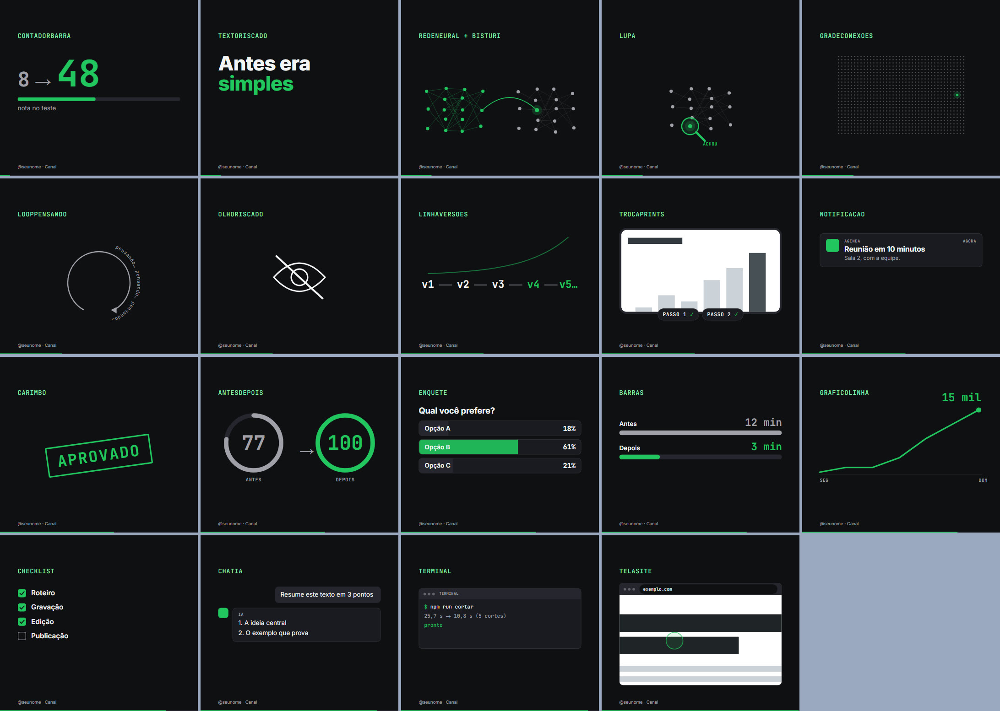
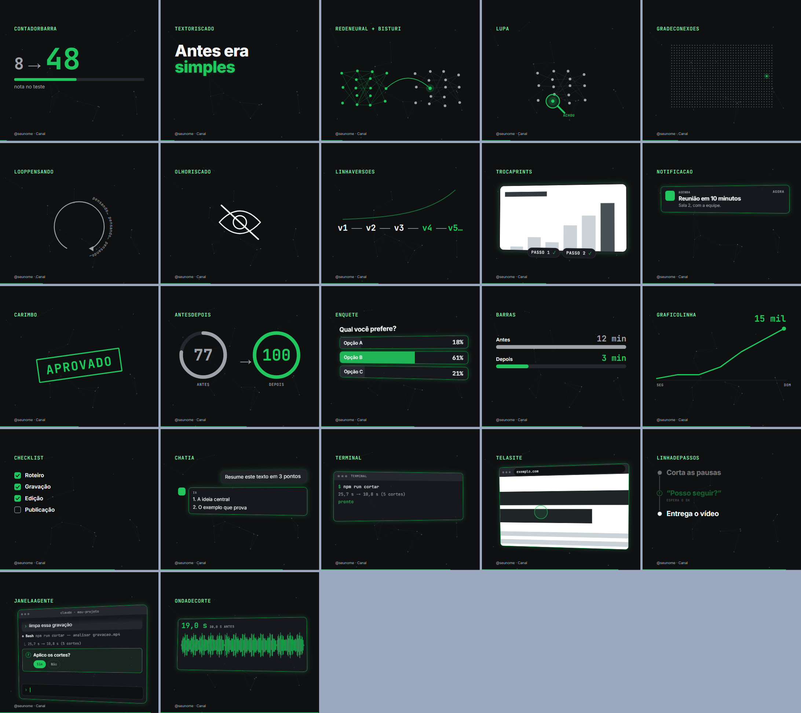
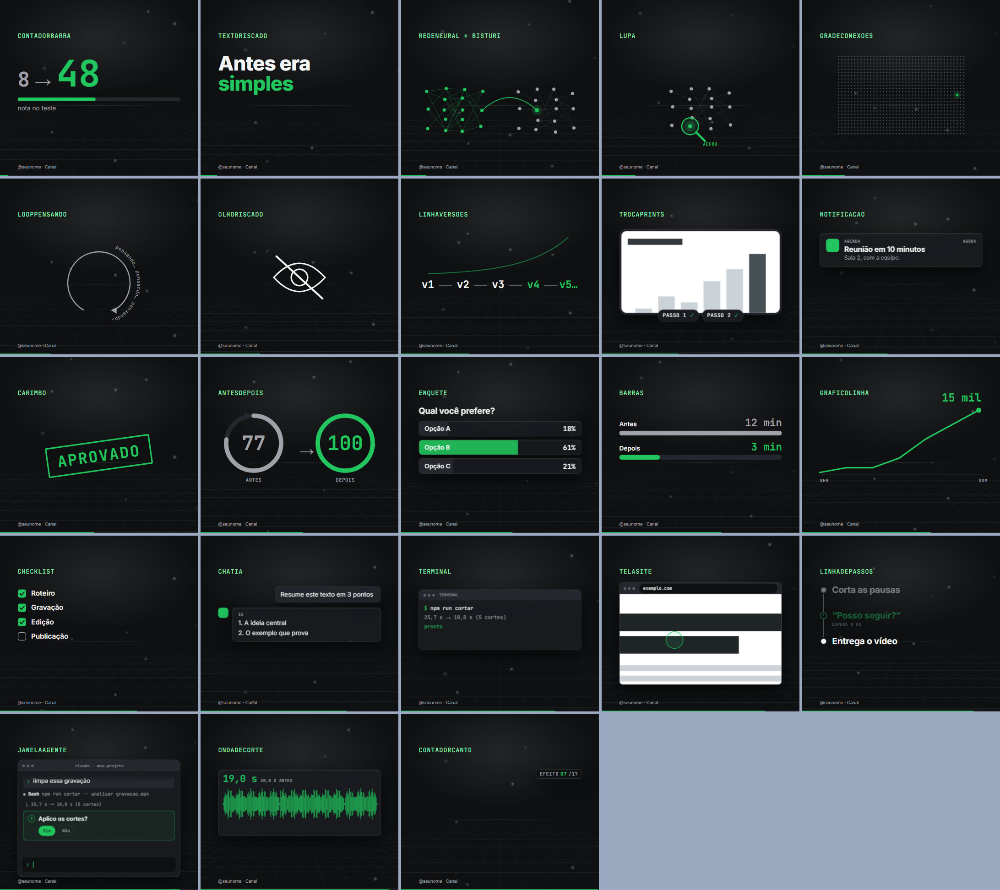
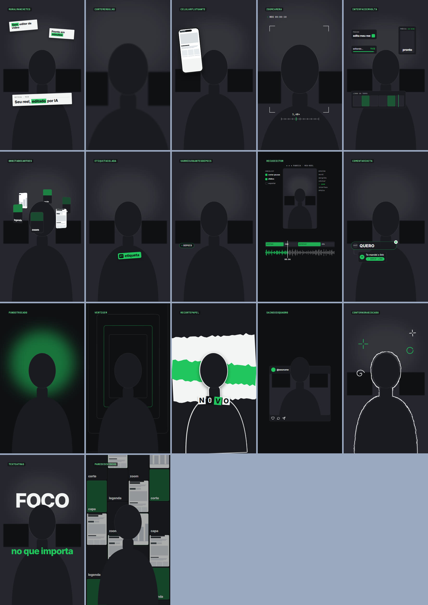

# Fábrica de Vídeos Agêntica

Um conjunto de skills para o Claude Code que transforma uma gravação de celular em Reels, Shorts e TikToks prontos: corta as pausas e os erros, anima o que você fala, legenda, confere e entrega. Você pede em português, como falaria com um editor.

Tudo roda no seu computador. As animações são feitas em código (Remotion) e a transcrição usa o Whisper local. Não precisa de chave de API de voz, imagem ou vídeo.



## O que ela faz

| Você diz | Skill | O que sai |
|---|---|---|
| "gravei isso, monta" | `/fabrica-videos-rapido` | Reel animado a partir da gravação, sem roteiro antes |
| "quero um reel sobre X" | `/fabrica-videos-reels` | Reel com roteiro e storyboard aprovados antes de gravar |
| "limpa essa gravação" | `/fabrica-videos-corte` | Vídeo sem silêncios, erros nem tomadas repetidas, com relatório |
| "põe legenda" | `/fabrica-videos-legendas` | Legenda queimada, com a palavra-chave na cor da marca |
| "que animação dá para pôr aqui?" | `/fabrica-videos-peca` | Uma peça da biblioteca, ou uma nova no padrão da marca |
| "mostra o site X" | `/fabrica-videos-print-site` | Print do site numa moldura de navegador, com rolagem e zoom |
| "quero outro formato" | `/fabrica-videos-formatos` | Tela dividida, rosto com janela, tela com rosto, tutorial mudo |
| "faz a capa" | `/fabrica-videos-capa` | Capa 1080×1920 dentro da área que aparece no grid |
| "fecha esse vídeo" | `/fabrica-videos-entrega` | Conferência de tamanho, codec e volume, capa e notas |
| "cria a minha marca" | `/fabrica-videos-marca` | Suas cores, fontes e assinatura em todas as peças; e o estilo de movimento, à parte (`mini-action`, `orbita` ou `palco`) |

Sem saber qual usar, comece por `/fabrica-videos`: ela pergunta o que você quer e chama a certa.

## Do que precisa

- **Claude Code**, com uma assinatura do Claude.
- **Node.js 20 ou mais novo** e **FFmpeg** no PATH.
- Cerca de **6 GB livres** (a conta está logo abaixo).
- Para corte automático, legenda e sincronização com a fala: placa de vídeo (ou chip gráfico integrado) com suporte a WebGPU, que é o que roda a transcrição. Isso ainda não foi testado num computador sem esse suporte. As animações, a capa e o print de site não dependem dele.

### O que será baixado

O repositório tem menos de 1 MB. O peso está no que ele baixa para funcionar, uma vez só:

| O quê | Em disco | Quando baixa |
|---|---|---|
| Dependências do projeto | ~0,9 GB | Na instalação (`npm install`) |
| Navegador interno do Remotion | ~0,3 GB (131 MB de download) | No primeiro render |
| Modelo de transcrição (Whisper) | ~4 GB | Só na primeira transcrição de uma fala |

Tudo fica dentro de `node_modules`, na pasta do projeto. Nada é instalado no sistema, e apagar essa pasta desfaz a instalação. Para ver essa lista com o que já está no seu computador e o espaço livre, sem baixar nada:

```bash
node scripts/montar.mjs explicar
```

Quem só quer as animações não precisa do modelo de 4 GB: ele só entra quando você pede corte automático, legenda ou sincronização com a fala.

O **recorte da pessoa** (opcional) usa Python 3.12 e o MediaPipe, num ambiente à parte de ~380 MB, com os modelos incluídos. O `npm run recortar` mostra os comandos para montar esse ambiente quando ele ainda não existe.

Testado no **Windows 11**. No macOS e no Linux os scripts são os mesmos, mas ninguém rodou tudo de ponta a ponta ainda: se você rodar, conte o que quebrou.

## Como começar

### Pelo Claude Code, com um pedido

Abra o Claude Code numa pasta vazia e cole:

```text
Instale a Fábrica de Vídeos Agêntica a partir de https://github.com/eduardogalbiati/fabrica-de-video-skills

1. Baixe o repositório para uma subpasta chamada fabrica-de-video-skills. Use o git se eu tiver; se não tiver, baixe o .zip do GitHub e extraia você mesmo.
2. Leia o README.md e o CLAUDE.md de lá.
3. Antes de baixar qualquer dependência, rode "node scripts/montar.mjs explicar", me mostre o que será baixado, quanto ocupa e quanto espaço livre eu tenho, e espere o meu ok.
4. Com o meu ok, rode "node scripts/montar.mjs demo" e me mostre a imagem docs/mostruario.jpg.
5. Não instale nenhum programa no sistema (Node, FFmpeg, git) sem me perguntar: se faltar algum, diga qual é e o comando para instalar.
6. No fim, diga qual pasta eu abro no Claude Code para usar as skills e qual é o primeiro comando.
```

### À mão

1. Baixe o repositório: botão **Code → Download ZIP** e extraia (a pasta sai com o nome `fabrica-de-video-skills-main`), ou clone com o git.
2. No terminal, dentro da pasta:

```bash
node scripts/montar.mjs demo
```

O `montar` começa mostrando o que será baixado. Depois confere o FFmpeg, baixa as dependências, cria a pasta de trabalho e termina renderizando o mostruário das peças em `docs/mostruario.jpg`. Se a imagem saiu, a instalação funciona.

Depois, abra a pasta no Claude Code e diga `/fabrica-videos-marca` para pôr as suas cores, ou `/fabrica-videos-rapido` com uma gravação.

As skills oficiais do Remotion ajudam a IA a escrever animações melhores. Elas não vêm neste repositório: instale a partir de `remotion-dev/skills`.

## Como é organizada

| Camada | O que é | Onde |
|---|---|---|
| **Motor** | Peças de animação, formatos, scripts | `src/`, `scripts/` |
| **Marca** | Cores, fontes, assinatura, nome, temas | `marca/` (a ativa) e `marcas/` (outras) |
| **Estilo** | Como se move e se desenha: entrada, flutuação, perspectiva, brilho, fundo. Independe da marca | `estilos/` (`mini-action`, o padrão, `orbita` e `palco`) |
| **Seus vídeos** | Um arquivo por vídeo, mais roteiro e storyboard | `src/videos/`, `roteiros/` |
| **Skills** | Os guias que a IA segue | `.claude/skills/` |
| **Trabalho** | Gravações e vídeos renderizados (fica fora do git) | `trabalho/` |

O vídeo de exemplo (`src/videos/Exemplo.tsx`, com `roteiros/exemplo*`) mostra o caminho inteiro com um assunto fictício. É dele que se copia para começar.

### Marca e estilo, separados

A marca diz quem fala (cores, fontes, assinatura). O estilo diz como a tela se move: no `mini-action`, cada coisa entra com fade e uma subida curta e fica parada; no `orbita`, os cartões flutuam inclinados em perspectiva, com a borda acesa e uma rede de pontos no fundo; no `palco`, cartões foscos flutuam de frente sobre um piso quadriculado em perspectiva, com luz de cima e destaque em itálico. Qualquer marca combina com qualquer estilo, e o mesmo vídeo sai em qualquer um sem mudar uma linha:

| Órbita | Palco |
|---|---|
|  |  |

```bash
npm run estilo -- ver orbita                                        # mostruário no estilo órbita
npm run renderizar -- Exemplo trabalho/out/exemplo-orbita.mp4 estilo=orbita
```

Como criar um estilo novo: `estilos/README.md`.

### Efeitos sobre a gravação

Além das peças, que ocupam a metade de cima da tela, há 17 efeitos que agem sobre o rosto em tela cheia. Os 10 primeiros funcionam sobre qualquer gravação:
- recortes de manchete em volta do rosto;
- mergulho de câmera entre dois planos;
- celular rolando um print ao lado da pessoa;
- zoom com o visor da câmera;
- painéis de app flutuando em volta;
- cartões em órbita;
- etiqueta colada num objeto;
- varredura antes/depois;
- recuo para dentro do editor;
- comentário com chamada.

Os outros 7 precisam da pessoa recortada do fundo:
- fundo trocado;
- vertigem;
- recorte de papel;
- cabeça saindo da moldura de um post;
- contorno desenhado à mão;
- palavra gigante atrás da cabeça;
- parede de vídeos.



O recorte roda no seu computador, com o MediaPipe (opcional; só ele pede Python):

```bash
npm run recortar -- "trabalho/public/gravacao.mp4" minha-gravacao     # → trabalho/public/recortes/minha-gravacao-pessoa.webm
npm run mostruario -- efeitos                                          # os 17 efeitos numa imagem
```

## O que ela não faz

- Não publica, não agenda e não envia nada. Quem publica é você.
- Não inventa número, print nem resposta de IA: o que aparece na tela sai da sua fala ou de material seu.
- Não gera voz. A voz provisória do sistema serve só para testar as animações.
- O recorte da pessoa é bom, mas não é perfeito. A borda pode "respirar" 1 a 2 px, e mão ou braço encostados na borda do quadro às vezes somem por alguns quadros. Confira a folha de contato.
- Não ouve. Som e sincronia de ouvido são sempre conferidos por uma pessoa.

## Conferir antes de contribuir

```bash
node ferramentas/verificar-guias.mjs       # todo caminho e comando citado nas skills existe?
node ferramentas/verificar-vazamento.mjs   # algum dado pessoal ou caminho de máquina escapou?
npm run retrato -- tirar antes             # antes de mexer no motor; depois: tirar depois e comparar antes depois
```

## Licenças de terceiros

O **Remotion** tem licença própria: é gratuito para pessoas e empresas pequenas, e empresas maiores precisam de licença paga. Confira a regra atual em remotion.dev antes de usar comercialmente. As fontes vêm do Google Fonts.

## Licença

[MIT](LICENSE). Você pode usar, copiar, modificar e redistribuir, inclusive em trabalho comercial, desde que mantenha o aviso de copyright e o texto da licença. O código vem sem garantia.

A licença cobre o que está neste repositório. O Remotion e as fontes seguem as licenças deles, descritas acima.
